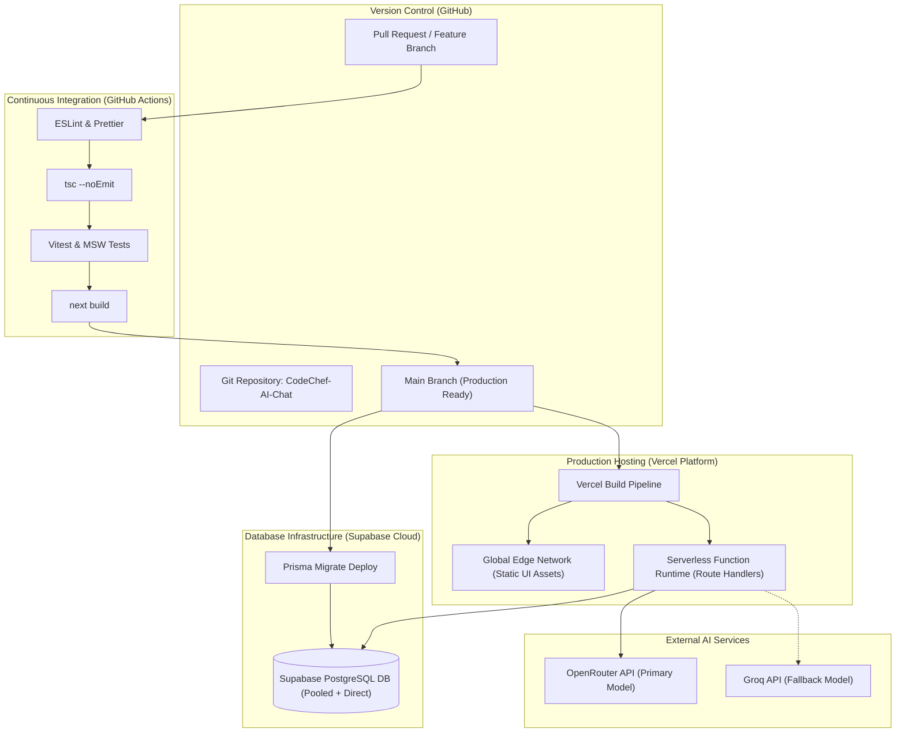

# Deployment Guide

## 1. Document Information

| Field | Description |
| --- | --- |
| Document Name | Deployment Guide |
| Project Name | `CodeChef-AI-Chat (Dolce Vita)` |
| Component / Application | Full-stack Web Application (Next.js App Router Monolith) |
| Document Version | 1.0.0 |
| Last Updated | 2026-11-06 |
| Status | Approved |
| Maintainers | Dolce Vita Engineering Team / Juan Pablo Arango (Docente UdeA) |

---

## 2. Purpose and Scope

### 2.1. Purpose

This document provides the definitive operational and technical guide for building, validating, packaging, deploying, and operating **Dolce Vita**, a full-stack conversational culinary application featuring **George**, an AI expert assistant.

It defines environment topologies, configuration management, automated CI/CD pipelines through GitHub Actions, database migration workflows with Prisma and Supabase PostgreSQL, deployment to the Vercel serverless platform, fallback integration with external AI providers (OpenRouter and Groq), post-deployment verification, and disaster rollback procedures.

### 2.2. Deployment Scope

| Component | Included | Description |
| --- | :---: | --- |
| **Backend / API** | Yes | Next.js App Router Route Handlers (`src/app/api/*`), controllers, services, repositories, and AI orchestration layer. |
| **Frontend / Web Application** | Yes | Next.js React client application with Tailwind CSS, responsive layouts, chat interface, and administrative dashboards. |
| **Mobile Application** | N/A | Excluded from project scope; application is fully responsive on mobile web browsers. |
| **Background Workers / Jobs** | N/A | Asynchronous operations are managed within serverless function lifecycles and HTTP requests. |
| **Supporting Services** | Yes | Supabase PostgreSQL managed database, Prisma schema migrations, OpenRouter API (Primary), and Groq API (Fallback). |

### 2.3. Deployment Boundaries

The application is deployed as a unified monolithic release on **Vercel**:

- Both frontend user interfaces and backend Route Handlers are built and distributed simultaneously.
- PostgreSQL persistence is provisioned independently in **Supabase Cloud**.
- AI inference is executed remotely via external REST APIs (OpenRouter and Groq) using server-side API keys.
- Local developer environments interact with cloud databases or local Docker PostgreSQL instances, while CI pipelines execute automated tests against isolated schemas.

---

## 3. Deployment Architecture

### 3.1. Deployment Overview

The deployment follows a GitOps continuous integration and continuous deployment (CI/CD) workflow:

1. Developers push commits to GitHub (`CodeChef-AI-Chat` repository).
2. Pull requests trigger GitHub Actions workflows that execute static analysis (ESLint, Prettier), TypeScript type checking, unit tests (Vitest), and build validation.
3. Upon merging into the `main` branch, the deployment workflow applies any pending database migrations to Supabase PostgreSQL using `prisma migrate deploy`.
4. Vercel automatically ingests the verified commit, compiles the Next.js application, optimizes static assets, bundles Route Handlers into edge/serverless execution lambdas, and promotes the deployment to production behind a global CDN.



### 3.2. Deployment Components

| Component | Runtime / Platform | Packaging / Artifact | Deployment Target | Deployment Strategy |
| --- | --- | --- | --- | --- |
| **Dolce Vita Web & API** | Node.js 20.x / Edge | Next.js Serverless Output (`.next`) | Vercel Platform | Zero-downtime rolling atomic deployment |
| **Database Schema** | PostgreSQL 15+ | Prisma Migration Files (`prisma/migrations/`) | Supabase PostgreSQL | Automated sequential migration execution (`prisma migrate deploy`) |
| **Static Assets** | Web CDN | Static HTML, CSS, client JS bundles, SVG icons | Vercel Global Edge Network | Content-addressed CDN distribution with caching |

### 3.3. Infrastructure and External Services

| Resource / Service | Purpose | Environment | Management / Ownership |
| --- | --- | --- | --- |
| **GitHub Repository** | Source code hosting, pull request reviews, and CI automation | Development, CI | Core Engineering Team |
| **Vercel** | Serverless hosting, preview deployments, custom domain routing, SSL termination | Production, Preview | Managed Cloud Platform |
| **Supabase PostgreSQL** | Managed relational persistence for users, conversations, messages, and configuration | Staging, Production | Managed Database Provider |
| **OpenRouter** | Primary AI inference provider routing requests to free/production models | Development, Production | Managed External API |
| **Groq** | Ultra-low-latency fallback AI provider invoked when OpenRouter fails or rate-limits | Development, Production | Managed External API |

### 3.4. Deployment Dependencies

Before a release can serve live traffic, the following dependencies must be confirmed operational:

1. **Active PostgreSQL Connection:** Supabase database must be reachable via both transaction-pooled connection strings (`DATABASE_URL`) and direct connection strings (`DIRECT_URL`).
2. **Schema Migration State:** All versioned SQL migrations in `prisma/migrations` must be applied without schema drift.
3. **Valid AI Provider Credentials:** Both `OPENROUTER_API_KEY` and `GROQ_API_KEY` must have active quotas and valid permissions.
4. **Valid Auth Configuration:** `AUTH_SECRET` must be set to ensure cookie signing and session token encryption.

---

## 4. Environment Management

### 4.1. Deployment Environments

| Environment | Purpose | Deployment Source | Configuration | Availability |
| --- | --- | --- | --- | --- |
| **Local** | Developer implementation, isolated debugging, and unit verification | Working branch on developer machine | `.env.local` (local secrets) | Developer workstation (`http://localhost:3000`) |
| **Testing / CI** | Automated linting, type checks, test execution, and contract validation | GitHub Pull Requests | GitHub Secrets & mocked services (MSW) | Ephemeral GitHub Actions runner |
| **Production** | Live academic delivery and grading by docente Juan Pablo Arango | Merges to `main` branch | Vercel Environment Variables | Public HTTPS Web URL (24/7) |

### 4.2. Environment Configuration

| Variable Name | Purpose | Required | Environments | Source |
| --- | --- | :---: | --- | --- |
| `DATABASE_URL` | Connection string for pooled PostgreSQL access (port 6543 / PgBouncer) | Yes | Local, CI, Production | Supabase Dashboard / Vercel Secrets |
| `DIRECT_URL` | Direct connection string for Prisma CLI migrations (port 5432) | Yes | Local, CI, Production | Supabase Dashboard / Vercel Secrets |
| `AUTH_SECRET` | Cryptographic key used by Auth.js to sign session cookies | Yes | Local, CI, Production | Generated with `openssl rand -base64 32` |
| `AUTH_URL` | Canonical base URL for Auth.js callbacks and redirects | Yes (Prod) | Production | Vercel Project URL / Custom Domain |
| `OPENROUTER_API_KEY` | Bearer API token for primary AI provider (OpenRouter) | Yes | Local, Production | OpenRouter Console |
| `OPENROUTER_MODEL` | Default model identifier (e.g. `openrouter/free` or specified model) | Yes | All | Project Configuration (`openrouter/free`) |
| `GROQ_API_KEY` | Bearer API token for fallback AI provider (Groq) | Yes | Local, Production | Groq Cloud Console |
| `GROQ_MODEL` | Fallback model identifier (e.g. `openai/gpt-oss-20b` or specified model) | Yes | All | Project Configuration (`openai/gpt-oss-20b`) |
| `AI_PRIMARY_PROVIDER` | Defines the default provider to invoke (`openrouter`) | Yes | All | Environment Configuration |
| `AI_FALLBACK_ENABLED` | Toggles automatic fallback execution on primary failure (`true`) | Yes | All | Environment Configuration |
| `AI_REQUEST_TIMEOUT` | Max millisecond duration before aborting an AI request (`30000`) | Yes | All | Environment Configuration |
| `NODE_ENV` | Identifies runtime mode (`development`, `test`, `production`) | Yes | All | System / Node.js Runtime |

### 4.3. Secrets and Sensitive Configuration

- **Storage:** Production secrets are stored exclusively in Vercel's encrypted Project Settings and GitHub Actions Secrets.
- **Injection:** Vercel injects environment variables into the serverless runtime environment at execution time. Secrets are never embedded into client-side JS bundles.
- **Access Control:** Restricted to project maintainers.
- **Local Development:** Developers create an untracked `.env.local` based on `.env.example`. Real credentials are never committed to Git.
- **No `NEXT_PUBLIC_` Exposure:** Secrets (database URLs, API tokens, auth secrets) strictly omit the `NEXT_PUBLIC_` prefix.

### 4.4. Configuration Validation

Runtime configuration is validated during application initialization using Zod in `src/lib/env.ts`. If any mandatory variable is missing or malformed, the process terminates immediately with an explicit error message before serving any HTTP traffic:

```typescript
import { z } from 'zod';

export const envSchema = z.object({
  DATABASE_URL: z.string().url(),
  DIRECT_URL: z.string().url(),
  AUTH_SECRET: z.string().min(16),
  OPENROUTER_API_KEY: z.string().min(1),
  OPENROUTER_MODEL: z.string().default('openrouter/free'),
  GROQ_API_KEY: z.string().min(1),
  GROQ_MODEL: z.string().default('openai/gpt-oss-20b'),
  AI_PRIMARY_PROVIDER: z.enum(['openrouter', 'groq']).default('openrouter'),
  AI_FALLBACK_ENABLED: z.string().transform(v => v === 'true').default('true'),
  AI_REQUEST_TIMEOUT: z.string().transform(Number).default('30000'),
  NODE_ENV: z.enum(['development', 'test', 'production']).default('development'),
});
```

---

## 5. Build and Packaging

### 5.1. Build Requirements

| Requirement | Version / Configuration | Purpose |
| --- | --- | --- |
| **Operating System** | Linux (CI / Vercel), Windows / macOS (Local dev) | Development and build host environment |
| **Node.js** | `>= 20.9.0` (LTS recommended) | JavaScript/TypeScript serverless runtime |
| **pnpm** | `>= 9.0.0` | Deterministic package manager |
| **Prisma CLI** | Matches `@prisma/client` (`^5.x` or `^6.x`) | Type generation and database schema migrations |
| **Memory** | Minimum 2GB RAM | Build-time bundle optimization and static generation |

### 5.2. Build Process

1. **Dependency Resolution:** `pnpm install --frozen-lockfile` downloads and validates exact dependencies against `pnpm-lock.yaml`.
2. **Prisma Client Generation:** `pnpm prisma generate` compiles the typed Prisma client based on `prisma/schema.prisma`.
3. **Static Analysis & Linting:** `pnpm lint` verifies code adherence to ESLint and Prettier rules.
4. **Type Verification:** `pnpm typecheck` (`tsc --noEmit`) validates complete TypeScript static types across client and server boundaries.
5. **Next.js Production Compilation:** `pnpm build` creates the production bundle (`.next`), compiles Route Handlers, compiles React Server Components, and minifies client assets.

### 5.3. Build Commands

```bash
# 1. Install dependencies with strict lockfile
pnpm install --frozen-lockfile

# 2. Generate Prisma Client bindings
pnpm prisma generate

# 3. Verify static typing and code style
pnpm typecheck
pnpm lint

# 4. Execute production build
pnpm build
```

### 5.4. Deployment Artifacts

| Artifact | Description | Output Location | Distribution / Storage |
| --- | --- | --- | --- |
| **Serverless Functions** | Compiled Route Handlers and server components | `.next/server/` | Vercel Serverless Function Engine |
| **Client Bundles** | Minified JavaScript and CSS files | `.next/static/` | Vercel Global Edge CDN |
| **Prisma Client** | Generated TypeScript database bindings | `node_modules/@prisma/client` | Bundled within server runtime |

### 5.5. Artifact Versioning

- Artifacts are linked to Git commit SHAs and semantic release tags (`v1.0.0-taller2`, `v1.1.0-proyecto-ia`).
- Vercel automatically associates every deployment URL with the corresponding commit hash and author.

---

## 6. Continuous Integration and Deployment (CI/CD)

### 6.1. Pipeline Overview

Dolce Vita employs a dual-stage automated pipeline implemented via GitHub Actions:

- **CI Workflow (`.github/workflows/ci.yml`):** Runs on every Pull Request to ensure that linting, types, unit tests, and the build pass without error.
- **CD Workflow (Vercel Git Integration):** Triggers upon merge to `main`. It deploys database migrations to Supabase, builds the production bundle, and activates the live URL.

### 6.2. Pipeline Triggers

| Trigger | Source Branch / Event | Target Environment | Expected Action |
| --- | --- | --- | --- |
| **Pull Request** | `feature/*`, `fix/*` | Testing / CI Runner | Run Lint, Typecheck, Vitest, and Trial Build |
| **Push** | `main` | Production (Vercel) | Migrate DB, Build, Deploy, and Verify Live Status |
| **Workflow Dispatch** | Manual trigger | Staging / Production | Run automated regression suite or force redeploy |

### 6.3. Pipeline Stages

1. **Source Retrieval:** Clones repository using `actions/checkout@v4` with full commit history.
2. **Environment Setup:** Configures Node.js 20.x via `actions/setup-node@v4` and installs `pnpm` via `pnpm/action-setup@v3`.
3. **Cache Resolution:** Restores pnpm dependency cache to optimize CI build times.
4. **Dependency Installation:** Executes `pnpm install --frozen-lockfile`.
5. **Quality Checks:** Runs ESLint and Prettier checks (`pnpm lint`).
6. **Static Typing:** Executes `pnpm typecheck` (`tsc --noEmit`).
7. **Automated Testing:** Runs unit and integration suites using `pnpm test:coverage`.
8. **Build Verification:** Executes `pnpm build`.
9. **Database Migration:** Executes `pnpm prisma migrate deploy` using `DIRECT_URL`.
10. **Deployment:** Vercel deploys compiled bundle and assigns live production alias.
11. **Post-Deployment Verification:** Automated smoke checks verify `/api/auth/providers` and home page responsiveness.

### 6.4. Quality Gates

| Check | Requirement | Failure Behavior |
| --- | --- | --- |
| **Linting & Formatting** | 0 ESLint errors; valid Prettier formatting | Pipeline fails; blocks PR merge |
| **TypeScript Compilation** | 0 type errors with strict mode enabled | Pipeline fails; blocks PR merge |
| **Unit & Integration Tests** | 100% test pass rate in Vitest | Pipeline fails; blocks PR merge |
| **Production Build** | `pnpm build` finishes with exit code 0 | Pipeline fails; blocks deployment |
| **Prisma Schema Drift** | Schema matches migration files | Pipeline fails; blocks database migration |

---

## 7. Deployment Procedures

### 7.1. Deployment Prerequisites

- [ ] Supabase PostgreSQL database created and connection strings recorded.
- [ ] Vercel account configured with GitHub repository access.
- [ ] All environment variables configured in Vercel Project Settings.
- [ ] Database credentials (`DIRECT_URL` and `DATABASE_URL`) tested.
- [ ] `AUTH_SECRET` generated using a 32-character secure random string.
- [ ] Active API keys for OpenRouter and Groq tested via curl or local test script.

### 7.2. Deployment Steps

#### Step 1: Database Migration Setup (Supabase)

Run database migrations from the local developer terminal or deployment runner:

```bash
# Validate schema consistency
pnpm prisma validate

# Apply migrations to Supabase PostgreSQL
pnpm prisma migrate deploy

# Seed initial admin user and George's default gastronomic assistant configuration
pnpm prisma db seed
```

#### Step 2: Vercel Project Configuration

1. Import the `CodeChef-AI-Chat` GitHub repository into the Vercel Dashboard.
2. Select **Next.js** as the Framework Preset.
3. Configure the Root Directory as `./` (or `CodeChef-AI-Chat` if deploying from a parent monorepo).
4. In **Build and Output Settings**:
   - Build Command: `pnpm prisma generate && pnpm build`
   - Install Command: `pnpm install`
5. In **Environment Variables**, supply all values documented in Section 4.2.

#### Step 3: Trigger Production Deployment

Push to the `main` branch or trigger via Vercel CLI:

```bash
# Optional manual deployment via Vercel CLI
pnpm vercel --prod
```

### 7.3. Platform-Specific Configuration

| Setting | Configuration | Purpose |
| --- | --- | --- |
| **Framework Preset** | Next.js | Automatically detects Route Handlers and Server Components |
| **Node.js Version** | `20.x` | Ensures compatibility with modern ECMAScript and Prisma features |
| **Build Command** | `pnpm prisma generate && pnpm build` | Guarantees Prisma client is generated before Next.js compiles routes |
| **Output Directory** | `.next` | Standard Next.js production build output |

### 7.4. Database and Data Changes

- **Additive Migrations:** Database migrations must always be backward-compatible (e.g., adding nullable columns, new tables, or new indexes) so that existing serverless functions do not fail while new code is deploying.
- **Seeding:** The seed script (`prisma/seed.ts`) idempotently creates:
  1. Default `ADMIN` account for academic evaluation.
  2. Active `AssistantConfig` record containing George's specialized gastronomic system prompt.

### 7.5. Post-Deployment Verification Checklist

- [ ] **Home Page:** Public landing page loads with HTTP 200, displays Dolce Vita branding, and shows introduction to George.
- [ ] **Authentication:** User registration succeeds; user can log in and session cookie is set with `HttpOnly` and `Secure`.
- [ ] **Conversational Chat:** Creating a new conversation succeeds; asking George a culinary question generates a structured Markdown response with ingredients and cooking steps.
- [ ] **AI Fallback Check:** George responds correctly; server logs confirm provider used (OpenRouter or Groq).
- [ ] **Conversation Persistence:** Refreshing the browser preserves conversation title and message history in the sidebar.
- [ ] **Message Editing:** Editing a previously sent message preserves the revision history and regenerates the subsequent response.
- [ ] **Feedback System:** Rating a message with thumbs up / thumbs down persists without error.
- [ ] **Admin Dashboard:** Logging in as `ADMIN` grants access to `/admin` routes showing user list, assistant configuration, and system statistics. Non-admin users are rejected with HTTP 403.

---

## 8. Release Management

### 8.1. Versioning Strategy

Dolce Vita follows Semantic Versioning (`MAJOR.MINOR.PATCH`):

- `v1.0.0-taller2`: Milestone 1 — Full responsive UI, Auth.js credentials, RBAC, Supabase PostgreSQL persistence, conversation CRUD, and simulated AI endpoint.
- `v1.1.0-proyecto-ia`: Milestone 2 (Final) — Real LLM integration (OpenRouter primary, Groq fallback), dynamic system prompt configuration, conversational context window, response editing, feedback, and academic demonstration test battery.

### 8.2. Release Types

| Release Type | Purpose | Approval | Distribution |
| --- | --- | --- | --- |
| **Preview Release** | Pull request verification on dynamic Vercel preview URLs | Automated CI checks | Ephemeral PR comment link |
| **Milestone Release** | Academic evaluative delivery for Taller 2 or Proyecto IA | Docente / Course Lead | Production Vercel URL |
| **Hotfix Release** | Urgent bugfix or fallback model configuration update | Engineering Team Lead | Production Vercel URL |

---

## 9. Rollback and Recovery

### 9.1. Rollback Strategy

Vercel maintains atomic immutable deployments. If a critical issue is discovered in production:

1. Navigate to the **Deployments** tab in the Vercel Dashboard.
2. Locate the previously verified stable deployment.
3. Click the menu and select **Instant Rollback (Promote to Production)**.
4. Traffic is shifted to the stable version in under 5 seconds with zero server restart time.

### 9.2. Rollback Triggers

- HTTP 500 error spike exceeding 2% of total requests over a 5-minute window.
- Unhandled authentication breakdown preventing user logins.
- Simultaneous outage of both OpenRouter and Groq providers resulting in total AI unresponsiveness.
- Critical security flaw or accidental secret exposure.

### 9.3. Data Compatibility During Rollback

Because Prisma migrations are executed sequentially, migrations should avoid destructive actions (such as dropping columns immediately). In the event of an application rollback, the previous code version will continue functioning against the database as long as additive schema designs were followed.

---

## 10. Monitoring and Operations

### 10.1. Application Health

- A dedicated health check endpoint is exposed at `GET /api/health`.
- The endpoint queries the database (`SELECT 1`) and verifies AI provider configuration readiness, returning a structured JSON status report:

```json
{
  "status": "healthy",
  "timestamp": "2026-11-06T17:00:00Z",
  "database": "connected",
  "providers": {
    "primary": "openrouter",
    "fallback": "groq",
    "fallbackEnabled": true
  }
}
```

### 10.2. Logging

- Runtime logs are streamed in real time to the **Vercel Runtime Logs** console.
- Log entries record timestamps, HTTP methods, route paths, response status codes, latency, and AI provider selections.
- Personal data, user passwords, and raw API keys are strictly redacted from log messages.

### 10.3. Monitoring and Alerts

| Metric / Signal | Purpose | Threshold / Condition | Alert Destination |
| --- | --- | --- | --- |
| **HTTP 5xx Error Rate** | Detect application runtime exceptions | > 5% over 5 minutes | Vercel Email / Slack notification |
| **AI Fallback Frequency** | Track primary provider (OpenRouter) degradation | > 10 fallbacks per hour | Administrative Dashboard Stats |
| **Database Pool Usage** | Monitor connection pool exhaustion | Connections > 80% capacity | Supabase Cloud Alert |

---

## 11. Security and Compliance

- **Transport Encryption:** 100% of external and internal communications require TLS 1.2+.
- **Access Control:** Production Vercel and Supabase dashboards require multi-factor authentication (MFA).
- **Environment Isolation:** Development database schemas are completely separated from production data.
- **Audit Logging:** Administrative changes to assistant configuration or user roles are recorded in persistent database records with timestamps and author references.

---

## 12. Backup and Maintenance

### 12.1. Backup Strategy

- **Automated Daily Backups:** Supabase automatically creates daily snapshots of the PostgreSQL database, retained for 7 days.
- **Pre-Migration Backups:** Prior to applying major schema migrations, developers export a database snapshot via pg_dump:

```bash
pg_dump -d "$DIRECT_URL" -F c -b -v -f "./backup-$(date +%Y%m%d%H%M%S).dump"
```

### 12.2. Maintenance Windows

Planned maintenance (such as schema updates or major package upgrades) is scheduled during low-traffic periods. Since Route Handlers run in serverless functions, application updates occur with zero downtime.

---

## 13. Deployment Checklist

### 13.1. Pre-Deployment

- [ ] Code reviewed and approved in Pull Request.
- [ ] Automated CI checks pass (Linting, TypeScript, Vitest tests).
- [ ] Prisma migration files created and committed to Git.
- [ ] Environment variables verified in Vercel project settings.

### 13.2. Deployment

- [ ] Pull request merged into `main`.
- [ ] `prisma migrate deploy` executed successfully against Supabase.
- [ ] Vercel build completes with exit code 0.
- [ ] Production URL updated.

### 13.3. Post-Deployment

- [ ] `/api/health` returns status healthy.
- [ ] Manual smoke test completed: login, chat with George, check markdown formatting, test message edit.
- [ ] Verify that admin metrics dashboard records activity.
- [ ] Vercel runtime logs inspected for unexpected exceptions.

---

## 14. Related Documentation

| Document | Relationship |
| --- | --- |
| `README.md` | Repository overview, developer setup, and local execution instructions. |
| `SPEC.md` | Product specification, feature descriptions, and user interaction flows. |
| `REQUIREMENTS.md` | Functional requirements (`FR-001` to `FR-021`) and non-functional requirements. |
| `ARCHITECTURE.md` | System structure, layered monolith boundaries, and technology decisions. |
| `DATABASE.md` | Relational schema, Prisma models, indexes, and entity relationships. |
| `SECURITY.md` | Security model, threat analysis, authentication, and access control. |
| `API.md` | Authoritative HTTP API contracts, parameters, DTOs, and error codes. |
| `PLAN.md` | Implementation plan, milestones, and task schedules. |

---

## 15. Change Log

| Version | Date | Author | Description |
| --- | --- | --- | --- |
| 1.0.0 | 2026-11-06 | Dolce Vita Core Team | Initial comprehensive deployment guide covering Vercel serverless hosting, Supabase PostgreSQL, Prisma migrations, CI/CD with GitHub Actions, and AI provider fallback operations. |
