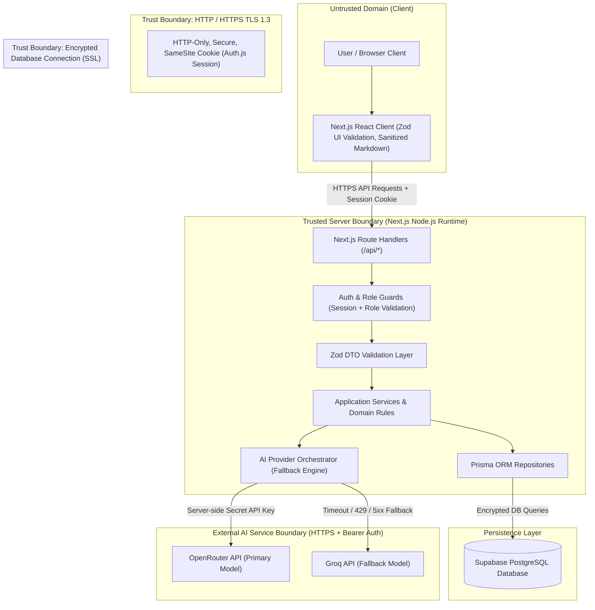

# Security Model

## 1. Document Information

| Field | Value |
| --- | --- |
| Project | `CodeChef-AI-Chat (Dolce Vita)` |
| Document | Security Model |
| Version | 1.0.0 |
| Status | Approved |
| Last Updated | 2026-11-06 |
| Owner | Dolce Vita Core Security & Engineering Team |

## 2. Purpose

This document defines the security model for **Dolce Vita**, a full-stack conversational application specialized in culinary assistance through its AI assistant, **George**.

It establishes the security objectives, trust boundaries, threat models, cryptographic requirements, access control policies, and operational controls necessary to protect user identities, conversational records, administrative capabilities, and external AI provider credentials.

Security in Dolce Vita is treated as a fundamental architectural pillar, implemented across all layers: client presentation, Next.js Route Handlers, application controllers and services, Prisma data access, Supabase PostgreSQL persistence, and external LLM provider integrations (OpenRouter and Groq).

## 3. Security Objectives

### 3.1 Protected Assets

The system protects the following critical assets:

- **User Authentication Credentials:** Passwords hashed with `bcryptjs` (minimum 10 salt rounds), active session tokens, and account linkage records.
- **Conversational Data:** Private user conversations, user messages, assistant responses, edit histories (`MessageRevision`), and user feedback ratings (`MessageFeedback`).
- **AI Infrastructure Credentials:** API keys for external language model providers (`OPENROUTER_API_KEY`, `GROQ_API_KEY`), which must strictly remain server-side.
- **Database Connection Credentials:** PostgreSQL connection strings (`DATABASE_URL`, `DIRECT_URL`) granting administrative database access.
- **System Instructions & Assistant Configuration:** George's specialized gastronomic system prompt, domain boundaries, and administrative behavioral overrides (`AssistantConfig`).
- **Administrative Operations:** Endpoints for role elevation, user auditing, configuration updates, and system-wide usage statistics.
- **Client Application Integrity:** Safe rendering of AI responses to prevent Cross-Site Scripting (XSS) and injection vulnerabilities.

### 3.2 Security Properties

| Property | Objective | System Implementation |
| --- | --- | --- |
| **Confidentiality** | Prevent unauthorized disclosure of user conversations, account data, and system secrets. | Server-side environment isolation, encrypted HTTPS transport, and strict resource-level query filtering in Prisma. |
| **Integrity** | Prevent tampering with message history, user roles, system prompts, or audit records. | Server-enforced mutations, Zod schema validation, database constraints, and immutable message revision logs. |
| **Authentication** | Positively verify the identity of registered users and administrators. | Auth.js (NextAuth.js v5) session management with secure, HTTP-only, SameSite cookies. |
| **Authorization** | Enforce least-privilege access and strict resource ownership. | Centralized server-side guards verifying session validity, user ownership (`userId == session.user.id`), and `ADMIN` role checks. |
| **Availability** | Ensure continuous access to the culinary assistant and withstand provider failures. | Automated provider fallback (OpenRouter primary to Groq secondary), request timeouts (30s), and graceful error degradation. |
| **Accountability** | Retain sufficient audit logs to investigate security-relevant events and abusive behavior. | Structured server logs recording authentication attempts, administrative updates, feedback, and AI provider errors. |
| **Privacy** | Protect user personal information and prevent culinary data leaks to third parties. | Data minimization in AI request payloads, stripping PII, and confining user interaction to isolated sessions. |
| **Non-repudiation** | Provide reliable evidence of message submissions, edits, ratings, and role changes. | Database records with unmodifiable timestamps (`createdAt`, `updatedAt`, `editedAt`) and foreign key associations. |

---

## 4. Security Architecture

### 4.1 Security Architecture Diagram



### 4.2 Security Responsibilities

| Component | Security Responsibility |
| --- | --- |
| **Client UI (React/Next.js)** | Client-side input pre-validation, tokenless session awareness via cookies, sanitized Markdown rendering (disabling raw HTML execution), and protection against UI redress/clickjacking. |
| **Route Handlers (`/api/*`)** | Enforce HTTP verb constraints, parse JSON payloads securely, verify authentication headers/cookies, reject malformed payloads, and return standardized, sanitized error objects. |
| **Auth & Role Guards** | Validate session token integrity, enforce role access rules (`ADMIN` vs. `USER`), and verify resource ownership (preventing Insecure Direct Object References). |
| **AI Orchestrator** | Safeguard upstream AI API keys, isolate prompt injection attempts, strip conversational context of cross-user data, enforce request timeouts, and coordinate provider fallback. |
| **Prisma ORM & Repositories** | Enforce parameterized queries to eliminate SQL injection, maintain relational integrity constraints, and scope all queries by authenticated user identifiers. |
| **Supabase PostgreSQL** | Enforce storage encryption at rest, secure network connections via SSL (`sslmode=require`), enforce schema constraints, and isolate database backups. |
| **CI/CD (GitHub Actions)** | Secure automated testing, dependency scanning, secret leakage prevention, and protected deployment triggers to Vercel. |

### 4.3 Trust Boundaries

1. **Client to Server Boundary:**
   - Any data received from the browser (headers, route parameters, request bodies) is treated as completely untrusted.
   - Client-side validation is purely for user experience; server-side Zod validation is authoritative.
   - User identity claims sent in request bodies are ignored; identity is strictly extracted from the validated server session.
2. **Server to Database Boundary:**
   - Communication with Supabase PostgreSQL uses TLS encryption.
   - All SQL execution is handled via Prisma's parameterized engine, completely preventing SQL injection.
3. **Server to External AI Provider Boundary:**
   - API keys are injected exclusively via server environment variables.
   - AI responses are treated as untrusted text: they are validated, normalized, and rendered via Markdown parsers that do not execute arbitrary HTML scripts.

---

## 5. Threat Model

### 5.1 Threat Identification

The system addresses the top security risks applicable to full-stack conversational AI systems:

- **T-001 (BOLA / IDOR):** Malicious users altering conversation or message IDs in URL parameters to inspect, modify, or delete another user's chat history.
- **T-002 (Prompt Injection & System Prompt Override):** Crafting adversarial prompts attempting to force George to ignore culinary bounds, execute instructions, or disclose system instructions.
- **T-003 (Credential Theft & Brute Force):** Automated credential-stuffing attacks against the registration and login endpoints.
- **T-004 (XSS via Markdown Rendering):** Injecting malicious JavaScript inside user messages or assistant responses rendered in the browser.
- **T-005 (API Key Exposure):** Leaking external AI keys (`OPENROUTER_API_KEY`, `GROQ_API_KEY`) or database secrets to the browser bundle or Git repository.
- **T-006 (Privilege Escalation):** Regular users attempting to access `/api/admin/*` endpoints to elevate roles or view system statistics.
- **T-007 (Denial of Service & Quota Exhaustion):** Rapid repeated message requests exhausting AI provider credit limits or database connections.
- **T-008 (AI Provider Interruption):** External outages or HTTP 429 rate limits from OpenRouter causing application-wide chat failures.

### 5.2 Threat Assessment

| ID | Threat | Affected Asset | Likelihood | Impact | Risk Level | Mitigation Strategy |
| --- | --- | --- | --- | --- | --- | --- |
| **T-001** | BOLA / IDOR on Conversations & Messages | User Conversational Privacy | High | High | **High** | Repository-level verification requiring `userId == session.user.id` on every query and mutation. |
| **T-002** | Prompt Injection / Jailbreak | Assistant Specialization & Reputation | High | Medium | **Medium** | System Prompt hard boundaries, negative constraints, temperature tuning, and post-generation format filtering. |
| **T-003** | Credential Stuffing & Weak Passwords | User Accounts | Medium | High | **High** | Password complexity rules enforced via Zod; passwords hashed with `bcryptjs` (cost factor 10); rate limiting on auth routes. |
| **T-004** | Stored XSS via Markdown | User Session & Client Security | Medium | High | **High** | `react-markdown` configured without `rehype-raw`; code highlighting isolated via `rehype-highlight`; HTML tags escaped. |
| **T-005** | API Key & Secret Leakage | AI Services & Financial Quota | Low | Critical | **High** | Strict absence of `NEXT_PUBLIC_` prefixes on secrets; `.gitignore` enforced; automated secret scanning in CI. |
| **T-006** | Unauthorized Administrative Access | System Users & Global Configuration | Medium | High | **High** | Server-side role check (`session.user.role === 'ADMIN'`) enforced at the controller and layout levels. |
| **T-007** | Rate Limit & Quota Exhaustion | Application Availability | Medium | Medium | **Medium** | Max input length constraints (4,000 characters), debounce on client submit, and request timeout aborts (30s). |
| **T-008** | AI Provider Outage / 429 Rate Limit | Assistant Response Availability | High | High | **High** | Automated dual-provider fallback: seamless rerouting to Groq if OpenRouter fails with network error, 429, or 5xx. |

### 5.3 Attack Surface

| Entry Point | Exposure | Potential Risk | Protection |
| --- | --- | --- | --- |
| **Landing & Auth Pages** (`/`, `/login`, `/register`) | Public | Phishing, brute-force registration, spam accounts | Form validation with Zod, HTTPS, rate limits, unique email constraints in DB. |
| **Auth API** (`/api/auth/[...nextauth]`) | Public | Credential brute-force, timing attacks | Auth.js security architecture, constant-time password comparison (`bcryptjs.compare`). |
| **Conversation Endpoints** (`/api/conversations/*`) | Authenticated | IDOR, unauthorized deletion or inspection | Mandatory session authentication, user-scoping in Prisma queries. |
| **Message Endpoints** (`/api/messages/*`) | Authenticated | Prompt injection, unauthorized message edits, DoS | Message size limits, user ownership checks, parent conversation validation. |
| **Feedback Endpoints** (`/api/feedback`) | Authenticated | Rating spam, unauthorized feedback spoofing | Uniqueness constraint (`messageId_userId_key`), verification that user owns conversation. |
| **Admin API** (`/api/admin/*`) | Restricted (`ADMIN`) | Unauthorized role elevation, prompt tampering | Server-side role guard (`ADMIN` check), strict audit logging. |
| **Supabase Database** | Managed Cloud | Direct unauthorized database access | Encrypted SSL connection, connection string held exclusively in server environment variables. |

---

## 6. Authentication

### 6.1 Authentication Mechanisms

| Actor | Authentication Mechanism | Identity Provider | Applicable Components |
| --- | --- | --- | --- |
| **End User (`USER`)** | Email + Password Credentials / Session Cookie | Internal Database via Auth.js & Prisma Adapter | Web UI, Chat API, Conversation History |
| **Administrator (`ADMIN`)** | Email + Password Credentials / Session Cookie | Internal Database via Auth.js & Prisma Adapter | Admin Dashboard, Role Management, Assistant Config |
| **Next.js Backend Service** | Connection String with Credentials | Supabase PostgreSQL | Prisma Client & Database Migrations |
| **External AI Providers** | Bearer API Key | OpenRouter / Groq | AI Orchestrator Layer |

### 6.2 Authentication Flow

```text
Visitor / User Browser
       │
       ▼  1. POST /api/auth/callback/credentials (Email + Plaintext Password over HTTPS)
Route Handler (Auth.js)
       │
       ▼  2. Fetch User Record by Email via Prisma
Supabase PostgreSQL
       │
       ▼  3. Verify Password Hash using bcryptjs.compare(password, user.passwordHash)
Auth.js Core
       │
       ├── Credentials Invalid ──► 4a. Return HTTP 401 (Generic "Invalid credentials" error)
       │
       └── Credentials Valid
               │
               ▼  4b. Issue Encrypted, Signed HTTP-Only Session Cookie
Browser Client
       │
       ▼  5. Subsequent Requests Include Session Cookie
Server Route Handlers
       │
       ▼  6. Auth.js decrypts session -> extracts userId & role -> attaches to Request Context
```

### 6.3 Credential Handling

- **No Plaintext Passwords:** Passwords submitted during registration are immediately hashed using `bcryptjs` with a cost factor (salt rounds) of 10. Passwords are never written to database logs or application traces.
- **Safe Error Responses:** Authentication failures return generic error messages (e.g., "Credenciales inválidas") to prevent account enumeration.
- **Environment Isolation:** Session secrets (`AUTH_SECRET`) are 32+ byte cryptographic random strings stored in environment variables.

### 6.4 Session Management

- **Cookie Security:** Auth.js session cookies are configured with `HttpOnly: true`, `Secure: true` (in production), and `SameSite: "lax"`.
- **Session Duration:** Active sessions are valid for a default period of 30 days, renewed automatically during active user engagement.
- **Logout Invalidation:** Triggering the logout action clears the session cookie and invalidates the session record in the database.

---

## 7. Authorization and Access Control

### 7.1 Authorization Model

Dolce Vita employs a dual-layer authorization strategy:

1. **Role-Based Access Control (RBAC):** Users are assigned either the `USER` or `ADMIN` role.
2. **Resource Ownership Authorization (Ownership-Based):** A `USER` has authority solely over resources where `resource.userId === session.user.id`.

### 7.2 Access Control Matrix

| Resource / Action | Unauthenticated Visitor | Authenticated User (`USER`) | Administrator (`ADMIN`) | Authorization Enforcement Location |
| --- | :---: | :---: | :---: | --- |
| **View Landing Page** | Allowed | Allowed | Allowed | Public Route (`src/app/page.tsx`) |
| **Register / Sign In** | Allowed | Denied (Redirect) | Denied (Redirect) | Auth Middleware & Route Handlers |
| **Create Conversation** | Denied (401) | Allowed (Own) | Allowed (Own) | `/api/conversations` (Session Check) |
| **List Own Conversations** | Denied (401) | Allowed (Own) | Allowed (Own) | `/api/conversations` (`where: { userId }`) |
| **Access Other's Conversation** | Denied (401) | **Denied (403/404)** | **Denied (403/404)** | Conversation Controller / Ownership Check |
| **Rename / Delete Conversation** | Denied (401) | Allowed (Own) | Allowed (Own) | `/api/conversations/[id]` (Ownership Check) |
| **Send Message in Conversation** | Denied (401) | Allowed (Own) | Allowed (Own) | `/api/messages` (Parent Conversation Ownership) |
| **Edit Message & Regenerate** | Denied (401) | Allowed (Own) | Allowed (Own) | `/api/messages/[id]` (Ownership Check) |
| **Submit Feedback** | Denied (401) | Allowed (Own) | Allowed (Own) | `/api/feedback` (Ownership Check) |
| **View Admin Dashboard** | Denied (401) | **Denied (403)** | Allowed | `/admin/*` Layout & Route Handlers |
| **Manage Users & Roles** | Denied (401) | **Denied (403)** | Allowed | `/api/admin/users` (Role Guard) |
| **Configure Assistant Prompt** | Denied (401) | **Denied (403)** | Allowed | `/api/admin/assistant` (Role Guard) |
| **View Global Statistics** | Denied (401) | **Denied (403)** | Allowed | `/api/admin/stats` (Role Guard) |

### 7.3 Authorization Requirements

- **Server-Side Enforcement:** Route Handlers must independently authenticate and authorize every request. Client-side navigation guards in React are strictly treated as cosmetic enhancements.
- **Default Deny:** All endpoints under `/api/*` (except explicit public auth callbacks) default to requiring an authenticated session. All endpoints under `/api/admin/*` default to requiring `role === 'ADMIN'`.

---

## 8. Data Protection and Privacy

### 8.1 Data Classification

| Classification | Description | Examples | Protection Requirements |
| --- | --- | --- | --- |
| **Public** | Information accessible without restrictions. | Landing page text, public UI branding, George's public bio. | Public caching allowed; integrity verified via source control. |
| **Internal** | System operational data. | Application logs, aggregated statistics, model fallback metrics. | Accessible only to system runtime and authorized administrators. |
| **Confidential** | Private user data. | User display names, email addresses, conversation histories, message contents, feedback comments. | Encrypted in transit (TLS 1.3), access restricted by resource ownership. |
| **Restricted** | Critical security credentials and system control data. | Password hashes, `AUTH_SECRET`, `OPENROUTER_API_KEY`, `GROQ_API_KEY`, database connection strings. | Strict environment variable isolation, never exposed to client, zero logging. |

### 8.2 Data Minimization

- Only necessary registration fields are stored: display name, email, and password hash.
- In external AI requests to OpenRouter and Groq, only the conversational message exchange (roles and text contents) is transmitted. No user IDs, email addresses, or database identifiers are sent to LLM providers.

### 8.3 Data at Rest & in Transit

- **In Transit:** All external communication (User to Next.js, Next.js to Supabase, Next.js to OpenRouter/Groq) strictly requires HTTPS with TLS 1.3 or TLS 1.2.
- **At Rest:** Supabase PostgreSQL encrypts tables, indexes, and backups at rest using industry-standard AES-256.

### 8.4 Data Retention and Deletion

- When a user deletes a conversation, database foreign keys are configured with cascading deletion (`ON DELETE CASCADE`) to permanently purge related messages, message revisions, and associated feedback.

---

## 9. Network and Communication Security

### 9.1 Transport Security

- Production deployments on Vercel automatically enforce HTTPS with HTTP Strict Transport Security (HSTS) headers.
- Next.js response headers configure:
  - `X-Content-Type-Options: nosniff`
  - `X-Frame-Options: DENY`
  - `Referrer-Policy: strict-origin-when-cross-origin`
  - `Permissions-Policy: camera=(), microphone=(), geolocation=()`

### 9.2 API Communication & CORS

- Because Dolce Vita is a unified monolithic Next.js application, API Route Handlers serve requests originating from the same domain.
- Cross-Origin Resource Sharing (CORS) is restricted to same-origin requests by default. External cross-origin requests without authorized origin headers are rejected.

---

## 10. Input Validation and Output Encoding

### 10.1 Input Validation

All incoming HTTP request bodies and URL query parameters are validated against immutable Zod schemas before entering the service layer:

- **User Registration:** Email format validation, password minimum length (8 characters), display name non-empty.
- **Message Submission:** Message string trimmed, minimum length 1 character, maximum length 4,000 characters to prevent memory exhaustion and token buffer overflows.
- **Conversation Renaming:** Title trimmed, minimum length 1 character, maximum length 100 characters.
- **Feedback Submission:** Rating strictly restricted to enum values (`POSITIVE` or `NEGATIVE`), optional comment capped at 500 characters.
- **Assistant Configuration:** System prompt non-empty, maximum length 10,000 characters.

### 10.2 Output Encoding & Markdown Sanitization

George generates rich gastronomic responses formatted in Markdown (lists of ingredients, tables, cooking steps, bold callouts).

- Responses are rendered via `react-markdown` bundled with `remark-gfm` and `rehype-highlight`.
- The parser is configured **without** `rehype-raw`, ensuring that any HTML tags injected by adversarial prompt outputs or user edits are rendered as harmless escaped text strings rather than executable DOM nodes.

---

## 11. Secrets and Credential Management

### 11.1 Secret Storage

| Environment | Secret Management Mechanism |
| --- | --- |
| **Local Development** | Uncommitted `.env.local` file (listed in `.gitignore`). |
| **CI / CD (GitHub Actions)** | Encrypted GitHub Repository Secrets. |
| **Production (Vercel)** | Vercel Project Environment Variables (Encrypted at rest, injected at runtime). |

### 11.2 Secret Handling Rules

- Under no circumstances shall variables holding API keys, secrets, or database URLs use the `NEXT_PUBLIC_` prefix.
- The repository `.gitignore` explicitly excludes `.env`, `.env.local`, `.env.production`, and `node_modules/`.
- Automated pre-commit checks and CI workflows audit pull requests for accidental secret commits.

### 11.3 Secret Exposure Incident Procedure

If any production key or secret is inadvertently exposed:

1. Immediately revoke and regenerate the compromised key in the provider console (OpenRouter, Groq, Supabase, or Vercel).
2. Update the environment variables across Vercel and GitHub Actions.
3. Trigger an immediate redeployment of the application to clear runtime process environments.
4. Review access logs in Supabase and provider dashboards for anomalous activity during the exposure window.

---

## 12. Local Storage, Databases, and Cloud Services

### 12.1 Database Security (Supabase PostgreSQL)

- **Connection Modes:** The application uses connection pooling (`DATABASE_URL`) for serverless request execution and direct connections (`DIRECT_URL`) for Prisma schema migrations.
- **SSL Verification:** All connections require `sslmode=require`.
- **Database Permissions:** The application connects using designated application credentials with access restricted to the application schema (`public`).

### 12.2 Client Storage Security

- No sensitive credentials, auth tokens, or private conversational transcripts are stored in browser `localStorage` or `sessionStorage`.
- Application state stored in browser memory is ephemeral and destroyed upon closing or reloading the tab.

---

## 13. Third-Party Services and Integrations

### 13.1 Integration Inventory

| Service | Purpose | Data Exchanged | Authentication | Security Controls |
| --- | --- | --- | --- | --- |
| **Supabase PostgreSQL** | Authoritative relational data persistence | Encrypted queries and transactional records | Connection credentials over TLS | IP restrictions, TLS required, daily automated backups. |
| **OpenRouter API** | Primary LLM inference provider for George | Chat conversation context (system + user messages) | Bearer API Key | 30s timeout, non-PII payload, fallback to Groq on failure. |
| **Groq API** | High-speed secondary fallback LLM provider | Chat conversation context on OpenRouter failure | Bearer API Key | 30s timeout, triggered on 429/5xx/timeout errors. |
| **Vercel** | Serverless hosting platform and CDN | Built application assets and runtime environment | Deploy Tokens & Git Integration | HTTPS automatic provisioning, isolated function sandboxes. |

### 13.2 Fallback and Resilience Security

When OpenRouter encounters network timeouts, HTTP 429 (rate limits), or HTTP 5xx errors, the `AIOrchestrator` automatically reroutes the request to Groq without surfacing internal provider connection strings or raw API stack traces to the end user. If both providers fail, the system returns a safe, user-friendly culinary degradation message.

---

## 14. Dependency and Software Supply Chain Security

- **Package Manager:** `pnpm` with deterministic lockfile (`pnpm-lock.yaml`) enforced in CI via `pnpm install --frozen-lockfile`.
- **Audit Cadence:** Automated dependency auditing via `pnpm audit` during CI runs.
- **Minimal Surface:** Extraneous packages are avoided; established libraries (`zod`, `bcryptjs`, `@auth/prisma-adapter`, `lucide-react`) are preferred over unvetted utilities.

---

## 15. Security Testing and Verification

### 15.1 Security Test Matrix

| ID | Scenario | Expected Result | Verification Method |
| --- | --- | --- | --- |
| **ST-001** | Unauthenticated user attempts to access `/api/conversations` | Request rejected with HTTP 401 Unauthorized | Automated Integration Test (Vitest) |
| **ST-002** | User `A` requests conversation owned by User `B` (`GET /api/conversations/[id]`) | Request rejected with HTTP 403 Forbidden or 404 Not Found | Automated Integration Test (Vitest) |
| **ST-003** | User `A` attempts to delete message owned by User `B` | Mutation rejected, database record unmodified | Automated Integration Test (Vitest) |
| **ST-004** | Regular `USER` attempts to access `/api/admin/users` | Request rejected with HTTP 403 Forbidden | Automated Integration Test (Vitest) |
| **ST-005** | Message submission payload exceeds 4,000 characters | Request rejected with HTTP 400 Bad Request and Zod validation error | Automated Unit/Integration Test |
| **ST-006** | Prompt containing malicious HTML `<script>alert(1)</script>` rendered in chat | Script tags escaped; rendered as literal text without execution | End-to-End Component Test (Playwright) |
| **ST-007** | OpenRouter returns HTTP 429 or timeout | AI Orchestrator seamlessly invokes Groq fallback and completes response | Mock Service Worker (MSW) Test |
| **ST-008** | SQL injection string passed as conversation title or search query | Query safely parameterized by Prisma; string stored as plain text | Automated Repository Test |

---

## 16. Security Incident Response

### 16.1 Incident Lifecycle

```text
1. Detection (Alerts / Vercel Logs / User Report)
       ↓
2. Triage & Severity Classification (Critical / High / Medium / Low)
       ↓
3. Containment (Revoke compromised token, rotate API keys, or disable affected route)
       ↓
4. Remediation (Deploy bugfix via hotfix pipeline)
       ↓
5. Verification (Run security test suite & manual verification)
       ↓
6. Post-Incident Review (Document root cause, update SECURITY.md)
```

### 16.2 Responsibilities

- **Security Lead:** Evaluates incident severity, revokes credentials, and authorizes production hotfixes.
- **Engineering Team:** Investigates root cause, implements code patches, and adds regression tests to the test suite.

---

## 17. Related Documentation

| Document | Purpose |
| --- | --- |
| `ARCHITECTURE.md` | System structure, layered monolith boundaries, and dependency rules. |
| `API.md` | Authoritative HTTP contracts, request/response DTOs, and error conventions. |
| `DATABASE.md` | PostgreSQL relational schema, indexes, and entity relationships. |
| `REQUIREMENTS.md` | Functional and non-functional requirements (`NFR-003`, `NFR-004`). |
| `DEPLOY.md` | Deployment procedures, CI/CD pipelines, and environment configuration. |
| `SPEC.md` | Product specification, core features, and user journeys. |
| `PLAN.md` | Technical implementation plan and milestones. |

---

## 18. Change Log

| Version | Date | Author | Description |
| --- | --- | --- | --- |
| 1.0.0 | 2026-11-06 | Dolce Vita Core Team | Initial comprehensive security model covering full-stack authentication, RBAC, IDOR prevention, AI provider fallback security, and threat mitigations. |
